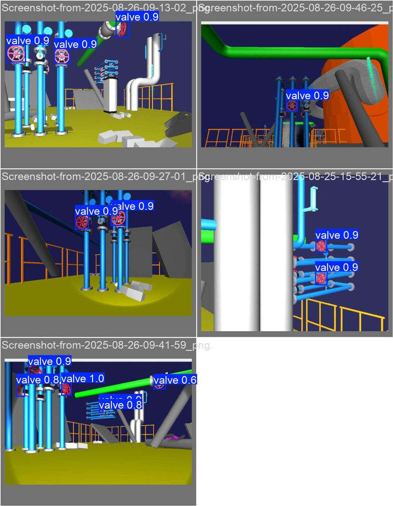
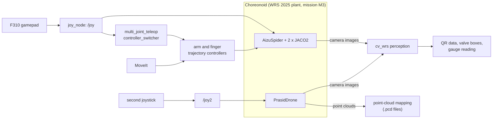
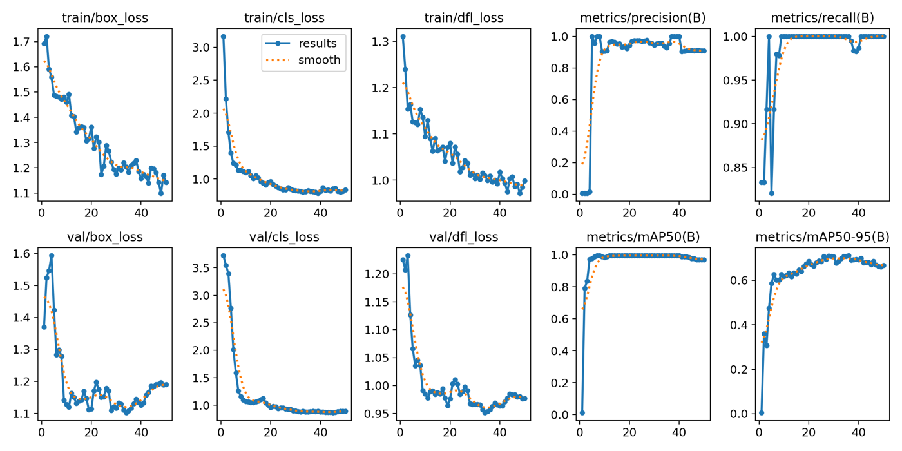

# WRS 2025 Simulation Disaster Challenge: team Prasid workspace

Our ROS 2 Humble workspace for the [World Robot Summit 2025 Harsh Environment F-REI Challenge, Simulation Disaster Challenge](https://github.com/wrs-frei-simulation/WRS-2025). The challenge runs in the Choreonoid simulator: robots explore a damaged plant, read QR codes, operate valves and read analog gauges.

We used an **AizuSpider** tracked robot with two **JACO2** arms and a **PrasidDrone**, our version of the challenge's HobbyDrone. On top of the official environment we added:

- **Arm control:** MoveIt and `ros2_control` for both arms, plus gamepad teleoperation.
- **Perception:** QR reading, a YOLOv8 valve detector and an EfficientNet gauge-reading model.
- **Mapping:** point clouds from the drone's cameras.
- **choreonoid_ros fixes:** the bridge no longer crashes on shutdown or when the simulation restarts.

This repository holds only our own work. `setup_workspace.sh` downloads the official sources at the exact versions we built on and applies our changes. Then you build as usual.



---

## What's here and what gets downloaded

| In this repository | Contents |
|---|---|
| `src/aizu_spider_description` | Robot description (AizuSpider + two JACO2 arms, HobbyDrone), `ros2_control` config, simulation and RViz launch files, point-cloud mapping scripts |
| `src/aizu_moveit` | MoveIt configuration for both arms, gamepad teleoperation and controller switching |
| `src/cv_wrs` | Perception node: QR codes, YOLOv8 valve detection, EfficientNet gauge regression (trained weights in `models/`) |
| `overlay/` | New files for the official WRS-2025 package: team Prasid robot models, controllers, Choreonoid projects, registration file |
| `patches/` | Our changes to existing files in Choreonoid, choreonoid_ros and WRS-2025 |
| `setup_workspace.sh` | Downloads the official sources, applies `patches/`, copies `overlay/` into `src/` |
| `setup_env.sh` | Activates the Python virtual environment, sources ROS 2 and the workspace |

| Downloaded into `src/` | Version | Our changes |
|---|---|---|
| [Choreonoid](https://github.com/choreonoid/choreonoid) | `c272f4d` (5 Aug 2025) | `patches/choreonoid.patch` |
| [choreonoid_ros](https://github.com/choreonoid/choreonoid_ros) | `34558e7` (17 Oct 2025) | `patches/choreonoid_ros.patch` |
| [WRS-2025](https://github.com/wrs-frei-simulation/WRS-2025) → `choreonoid/ext/WRS2025` | `1f54338` (30 Aug 2025) | `patches/WRS2025.patch` + `overlay/` |
| [WRS-Pre-2024](https://github.com/wrs-frei-simulation/WRS-Pre-2024) → `choreonoid/ext/WRS2024PRE` | `e953c13` (12 Jun 2025) | none |
| [choreonoid_joy2](https://github.com/wrs-sim/choreonoid_joy2) | `a3925ce` (13 Oct 2025) | none |
| **hairo-world-plugin** → `choreonoid/ext/hairo-world-plugin` | from the organisers | none; **not included**, see below |

The script rebuilds the workspace we used, file for file. Only three things differ: hairo-world-plugin, which you add yourself; an unused path setting we removed from `registration_m3.yaml`; and the copyright line in choreonoid_joy2's `LICENSE`, which now matches upstream.

## System overview



Choreonoid talks to ROS 2 through `choreonoid_ros`. `BodyROS2Item` publishes the cameras and joint states. `ROS2ControlItem` runs the controller manager for the arms.

---

## Setup

### Requirements

- Ubuntu 22.04 (amd64), **ROS 2 Humble**
- An NVIDIA GPU with the proprietary driver (we used an RTX 20-series card)
- **hairo-world-plugin.** The WRS organisers provide it on request (see the [official instructions](https://github.com/wrs-frei-simulation/WRS-2025#hairoworldplugin-installation-reference)). The WRS-2025 package does not build without it. It is not redistributed here.

### 1. Clone and fetch the sources

```bash
git clone git@github.com:adithya2204/wrs_2025.git ~/wrs_2025
cd ~/wrs_2025
./setup_workspace.sh
```

Then copy the plugin folder from the organisers to `src/choreonoid/ext/hairo-world-plugin`. You can run `./setup_workspace.sh` again at any time: it skips what is already in place and reports whether the plugin was found.

### 2. Install the system dependencies

```bash
src/choreonoid/misc/script/install-requisites-ubuntu-22.04.sh
rosdep install --from-paths src --ignore-src -r -y
```

### 3. Python environment for perception

PyTorch and Ultralytics live in a local virtual environment so that they don't clash with the system packages:

```bash
python3 -m venv .venv
source .venv/bin/activate
pip install --upgrade pip
pip install -r requirements.txt
```

### 4. Build

```bash
colcon build --symlink-install --cmake-args \
  -DCMAKE_BUILD_TYPE=Release \
  -DBUILD_SCENE_EFFECTS_PLUGIN=ON \
  -DBUILD_HAIRO_WORLD_PLUGIN=ON \
  -DBUILD_WRS2018=ON \
  -DBUILD_WRS2025=ON \
  -DENABLE_INSTALL_RPATH_USE_LINK_PATH=ON \
  -DPYTHON_EXECUTABLE=$(pwd)/.venv/bin/python3
```

To use the AGX Dynamics simulator as well, add `-DBUILD_AGX_DYNAMICS_PLUGIN=ON -DBUILD_AGX_BODYEXTENSION_PLUGIN=ON`. This needs an AGX licence from the organisers. Our project uses the AIST simulator.

### 5. Source the environment

`setup_env.sh` does four things: it activates the virtual environment, sources ROS 2 and the workspace, adds the virtual environment's packages to `PYTHONPATH`, and sets `WRS_WS` to the workspace folder. The launch files use `WRS_WS` to find the project file.

```bash
echo 'source ~/wrs_2025/setup_env.sh' >> ~/.bashrc
source ~/.bashrc
```

---

## Running

The ROS 2 controllers need the physics engine to be running, so **start these in order, each in its own terminal**:

```bash
# 1. Simulation: Choreonoid with project_prasid/Aizu_modified_M3.cnoid, plus robot_state_publisher
ros2 launch aizu_spider_description sim.launch.py
```

When the Choreonoid window opens, press **Play (▶)** on the toolbar to start the physics before you go on.

```bash
# 2. Arm and finger trajectory controllers
ros2 launch aizu_spider_description controller_spawner.launch.py

# 3. MoveIt, RViz, joy_node and gamepad teleoperation
ros2 launch aizu_moveit moveit.launch.py
```

### Gamepad

The teleoperation is mapped for a **Logitech F310 in XInput mode**. The centre (Logitech) button switches between two modes, published on `/active_controller`:
- `choreonoid`: the gamepad drives the robot through its Choreonoid controller.
- `teleop`: `multi_joint_teleop` drives the arms, sending joint trajectories to `/arm{1,2}_manipulator_controller` and `/arm{1,2}_fingers_controller`.

The drone's controller listens on `/joy2` (`/joy3` for the `PrasidDrone1` variant), so it needs a second joystick node. For example: `ros2 run joy joy_node --ros-args -p device_id:=1 -r joy:=joy2`.

### Perception

```bash
ros2 run cv_wrs perception_node
```

The node shows one camera at a time in a **Perception** window. It cycles through the drone's front, back, bottom and top cameras and the camera on arm 2. Keys, with the window focused:

| Key | Action |
|---|---|
| `c` / `b` | next / previous camera |
| `p` | read the gauge in the current frame (printed to the terminal) |
| `q` | quit |

| Topic | Type | Content |
|---|---|---|
| `/enhanced/combined_detection` | `sensor_msgs/Image` | camera image with valve boxes and QR overlay |
| `/detection/qr_data` | `std_msgs/String` | JSON with the decoded QR text and a timestamp |
| `/detection/gauge_reading` | `std_msgs/Int64` | gauge value predicted on a 0–1 scale, times 10⁶ |

Parameters: `camera_topics` (list), `yolo_conf` (default 0.8) and `enable_gui` (default true).

**Models**
- **Valve detector:** YOLOv8n, trained for 50 epochs on screenshots of the simulated plant (640 px, batch 8, AdamW). On its 5 validation images it reached mAP50 0.995 and mAP50-95 0.71 at its best epoch.
- **Gauge regressor:** an EfficientNet-B0 backbone with a small regression head. It outputs the dial position on a 0–1 scale.



### Point-cloud mapping

Scripts in `aizu_spider_description/scripts` collect the drone's camera point clouds into one voxel-filtered map. Press Ctrl+C to save it as a `.pcd` file.

```bash
ros2 run aizu_spider_description front_cloud_recorder.py                    # front camera only
python3 src/aizu_spider_description/scripts/multi_camera_pcd_accumulator.py  # all four drone cameras
```

---

## Our changes to the official code

| Patch / folder | What changed |
|---|---|
| `patches/choreonoid_ros.patch` | **Crash fixes.** `BodyROS2Item` releases its publishers and services and removes the node *before* stopping the executor. `ROS2ControlItem` tears down old ROS state and uses a unique node name, so a simulation can be restarted. `choreonoid_ros2` no longer calls `rclcpp::shutdown()` while ROS items are still being destroyed. The reasons are in the code comments. |
| `patches/choreonoid.patch` | `AizuSpiderController` takes gamepad input over ROS 2 (`/joy`). `Jaco2Controller` gets button edge detection and an initialised finger state. The AizuSpider's four body cameras switch to colour plus depth at 320 × 240, 10 fps, and the model gets an arm light. |
| `patches/WRS2025.patch` | Build rules for our ROS 2 controllers. `AizuSpiderDA-ROS2.cnoid`: the arms run through `ROS2ControlItem` instead of the joystick `Jaco2Controller`. `HobbyDrone-ROS2.cnoid` loads PrasidDrone. The M3 world drops the firefighting objects (area A2). `registration_m3.yaml` loads the M2 areas, with a new start position and recording on. |
| `overlay/choreonoid/ext/WRS2025` | Team Prasid models (`model_prasid/`: AizuSpiderDA and NA, JACO2, PrasidDrone), controllers (`AizuSpiderController`, `HobbyDroneJoystickController`), projects (`project_prasid/`) and `registration_m3_team_prasid.yaml` |

### Changing the official code

After `setup_workspace.sh`, the downloaded folders are ordinary git checkouts, so `git diff` shows the patches applied. If you change an existing file there, regenerate the patch from inside that folder:

```bash
git -C src/choreonoid_ros diff > patches/choreonoid_ros.patch
git -C src/choreonoid diff > patches/choreonoid.patch
git -C src/choreonoid/ext/WRS2025 diff > patches/WRS2025.patch
```

`git diff` does not include new files. Put new files under `overlay/`, in the same path they have under `src/`.

---

## Credits and licences

- **Choreonoid** (MIT) and **choreonoid_ros** (MIT): AIST and the Choreonoid developers
- **WRS-2025** and **WRS-Pre-2024** environments: the WRS F-REI simulation organisers
- **choreonoid_joy2** (MIT): wrs-sim
- **hairo-world-plugin:** Japan Atomic Energy Agency (JAEA), available from the organisers
- **Robot meshes:** from Choreonoid's AizuSpider and JACO2 sample models

Our packages carry their licences in their `package.xml`: Apache-2.0 for `aizu_spider_description`, BSD-3-Clause for `aizu_moveit` and MIT for `cv_wrs`.
